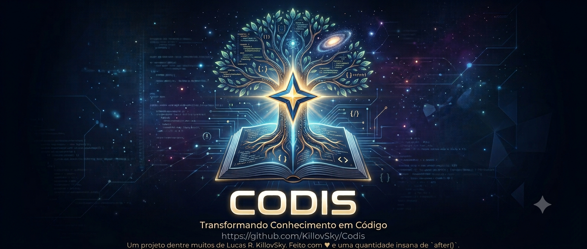

<div align="center">



<h1>Codis · Aether</h1>

<p><strong>Editor de código moderno, 100% Python + Tkinter - sem Electron, sem Node, extremamente customizável.</strong></p>

<p>
  <a href="https://github.com/KillovSky/Codis/releases"></a>
  <a href="https://www.python.org/downloads/"></a>
  <a href="LICENSE"></a>
  <a href="https://github.com/KillovSky/Codis/stargazers"></a>
</p>

<p>
  <a href="https://github.com/KillovSky/Codis/actions/workflows/pipeline.yml"></a>
  <a href="https://github.com/KillovSky/Codis/actions/workflows/codeql.yml"></a>
  <a href="https://github.com/KillovSky/Codis/releases"></a>
  <a href="https://github.com/KillovSky/Codis/discussions"></a>
</p>

<p>
  <a href="https://killovsky.github.io/Codis/"><strong>🌐 Site Oficial</strong></a> ·
  <a href="wiki/primeiros-passos.md"><strong>🚀 Começar agora</strong></a> ·
  <a href="wiki/Home.md"><strong>📖 Wiki completa</strong></a> ·
  <a href="https://github.com/KillovSky/Codis/issues/new?template=bug_report.yml"><strong>🐛 Reportar bug</strong></a> ·
  <a href="https://github.com/KillovSky/Codis/discussions"><strong>💬 Discussões</strong></a>
</p>

</div>

---

## ⚡ Início Rápido

```bash
git clone https://github.com/KillovSky/Codis.git
cd Codis
pip install -r requirements.txt   # opcional, mas recomendado
python run.py
```

> **Windows** → `pythonw run.py` (sem janela de console)
> **Linux/macOS** → `python3 run.py`
> **Requisito:** Python 3.12+ com Tkinter (`sudo apt install python3-tk` no Ubuntu/Debian)

Problemas para rodar? Diagnostique seu ambiente automaticamente:
```bash
python doctor.py
```

📦 [Dependências opcionais e guia de builds →](wiki/primeiros-passos.md)
🌐 [Site oficial com documentação visual →](https://killovsky.github.io/Codis/)

---

## ✦ O que é o Codis?

O **Codis** é um editor de código **desktop completo** escrito do zero em Python puro com Tkinter. A proposta é provar que é possível construir uma ferramenta de desenvolvimento moderna, fluida e visualmente expressiva sem depender de Electron ou Node.js - apenas Python e criatividade.

Um editor com UI exclusiva, sistema de plugins com sandbox, assistente de IA multi-provedor, SQL Studio integrado, Vim Mode imersivo, integração LSP nativa, documentação nativa para 27 linguagens (KDocs) e highlight de sintaxe para 25 linguagens (48 reconhecidas por extensão) - tudo em Tkinter.

### Visão geral por área

| Área | Destaques |
|---|---|
| ✏️ **Editor** | 25 linguagens com highlight (48 reconhecidas), autocomplete, snippets VSCode-style, Vim Mode, minimap, multi-cursor, smart selection, code folding |
| 🎨 **Interface** | 21 temas built-in, K-UI holográfico com nebulosas e animações, 40+ painéis, Activity Bar responsiva |
| 🗄 **SQL Studio** | SQLite · PostgreSQL · MySQL · DuckDB integrados, browser de esquema, editor com highlight e autocomplete, exportação CSV/JSON |
| 📚 **Documentação** | KDocs: Python Google/NumPy/Sphinx · Rust `///` · Go godoc · Ruby YARD · Lua LDoc · Doxygen · C# XML · JSDoc - hover rico em qualquer linguagem |
| 🔍 **Análise** | ESLint · Flake8 · Mypy · Pylint · Stylelint - diagnósticos inline, no gutter e no painel de problemas |
| 🔗 **LSP** | Go to Definition, Find References, Rename Symbol, hover semântico via language servers externos |
| 🌿 **Git** | Stage, commit, push/pull, branches, diff visual, clone com progresso, blame inline, autenticação integrada |
| 🤖 **IA** | Anthropic (Claude) · OpenAI · OpenAI-compatível (LM Studio, Groq…) · Gemini · Ollama · GGUF local, 15 Skills especializadas e 40 ferramentas com Approval Gate, diff interativo de respostas |
| ✅ **Tarefas** | Kanban (Backlog / Em Andamento / Revisão / Concluído) + Agendador de comandos shell com log de execução |
| 🧩 **Plugins** | API com eventos com prioridade, painéis customizados, armazenamento persistente, sandbox estática |
| 🛠️ **Ferramentas** | Terminal integrado, REST Client, Regex Playground, Color Picker, Pomodoro, Flowchart, Scratchpad |
| 🌍 **Localização** | 14 idiomas de interface com PT-BR como padrão; 4.633 chaves de tradução em pt-BR/en e 4.490 nos demais idiomas (o restante cai para pt-BR) |

---

## ✦ K-UI - A Engine Cósmica (Beta)

> **Por que fazer isso?** Por que não?
> Nada do K-UI é ativado sem sua permissão e nada consome recursos até você explicitamente habilitar.

O **K-UI** é um modo visual completamente opcional e exclusivo do Codis, com animações em thread separada via PIL:

- **Nebulosas e auroras** - geradas proceduralmente, animadas em tempo real
- **Sistema solar de arquivos** - cada arquivo aberto orbita como planeta na tela de boas-vindas
- **Partículas quânticas** - reagem à velocidade de digitação
- **Buracos negros** - crescem proporcionalmente à quantidade de erros de lint
- **Wormholes, cometas, satélites** e eventos cósmicos raros
- **Easter eggs** - ativados por sequências de teclado no terminal

```
Ctrl+Alt+N  →  ativar / desativar K-UI
Ctrl+Space  →  Spotlight holográfico (paleta de comandos)
```

→ [Documentação completa do K-UI](wiki/kui.md)

---

## 🗄 SQL Studio

O **SQL Studio** é um ambiente completo de banco de dados integrado diretamente ao editor, acessível pela Activity Bar (`🗄`), pela aba inferior (`🗄 SQL`) ou pelo atalho `Ctrl+Shift+Q`.

```
Drivers:  SQLite (built-in) · PostgreSQL (psycopg2) · MySQL (pymysql) · DuckDB (duckdb)
```

| Recurso | Descrição |
|---|---|
| **Browser de Esquema** | Árvore de tabelas → colunas (com tipo, `🔑 PK`, `! NOT NULL`) |
| **Editor SQL** | Syntax highlighting, numeração de linhas, autocomplete `Ctrl+Space` |
| **Execução** | `F5` / `Ctrl+Enter` para query completa · botão **Seleção** para trecho selecionado |
| **EXPLAIN** | Plano de execução com um clique |
| **Grid de Resultados** | Ordenação por coluna, exportação CSV / JSON |
| **Histórico** | Até 500 queries com preview e filtro de favoritos |
| **Conexões salvas** | Múltiplos perfis em `~/.codis/sql_connections.json` |
| **Multi-thread seguro** | Queries e schema loading em thread separada, lock para SQLite |

→ [Documentação do SQL Studio](wiki/recursos-avancados.md#sql-studio)

---

## ✅ Gerenciador de Tarefas

O **Task Manager** oferece duas visões integradas, acessíveis pelo ícone `✅` na Activity Bar (sem atalho de teclado dedicado):

**Kanban** - quadro visual com quatro colunas:

```
Backlog  →  Em Andamento  →  Revisão  →  Concluído
```

**Lista** - tabela filtrável com ordenação por prioridade, status e vencimento.

**⏰ Agendador de Comandos** - aba dedicada para executar comandos shell automaticamente:

| Modo | Exemplo |
|---|---|
| Uma vez | `2026-12-31 23:59` |
| A cada N minutos | a cada 30 min |
| A cada N horas | a cada 2 h |
| Todo dia | `08:00` |
| Toda semana | Sexta às `09:00` |

→ [Documentação do Task Manager](wiki/recursos-avancados.md#gerenciador-de-tarefas)

---

## 📚 Documentação Nativa (KDocs)

O **KDocs** analisa comentários e docstrings diretamente no arquivo, sem LSP, e exibe um balloon rico ao passar o mouse sobre qualquer símbolo documentado:

| Linguagem | Estilo Detectado |
|---|---|
| Python `.py` | Google Style · NumPy Style · Sphinx/reST |
| Rust `.rs` | `///` doc comments com seções Markdown |
| Go `.go` | godoc - comentários antes de declarações |
| Ruby `.rb` | YARD (`@param`, `@return`, `@raise`) |
| Lua `.lua` | LDoc (`---`, `@tparam`, `@treturn`) |
| C / C++ `.c/.cpp` | Doxygen (`@param`, `\brief`, `@returns`) |
| C# `.cs` | XML doc comments (`<summary>`, `<param>`) |
| JS / TS / Java / Kotlin / PHP / Dart | JSDoc / TSDoc completo |
| Qualquer linguagem | Anotações `@kdocs:` em comentários da linguagem |

→ [Documentação completa do KDocs](wiki/kdocs.md)

---

## 🤖 Assistente de IA

```
Providers:  Anthropic (Claude) · OpenAI · OpenAI-compatível · Gemini (Google) · Ollama · GGUF local
Skills:     Fix · Explain · Refactor · Review · Document · Generate · Optimize · Security ···
Contexto:   arquivo ativo · cursor · lint · imports · símbolos · TODOs · histórico
```

→ [Documentação da IA](wiki/ia.md)

---

## 💬 Chat ao Vivo

O **Chat Panel** é um cliente de mensageria multi-protocolo embutido diretamente no Codis. Use para comunicar com sua equipe sem trocar de janela enquanto programa.

```
Acesso: Configurações → Remoto & Colaboração → Chat ao Vivo
```

| Protocolo | Implementação |
|---|---|
| **IRC / IRCS** | RFC 1459, NickServ, TLS, SASL PLAIN, reconexão automática |
| **XMPP / Jabber** | XML stream RFC 6120, salas MUC, SASL PLAIN/ANON |
| **Matrix** | Client-Server API v3 via HTTP REST puro, login por senha ou token |
| **Slack** | RTM API v1 via WebSocket + REST (`xoxb-*`) |
| **Discord** | Gateway v10 via WebSocket (token Bot ou usuário) |
| **Telegram** | Bot API via long-polling HTTP (token do BotFather) |
| **Mattermost** | WebSocket API v4 com auto-detecção, self-hosted |
| **MQTT** | Pub/sub via socket raw; topics = canais; sem deps externas |
| **WebSocket** | WS/WSS genérico - protocolo JSON do Codis ou texto simples |

Matrix, Telegram e XMPP usam apenas a stdlib Python - sem dependências externas. Slack e Discord requerem `pip install websockets`.

→ [Documentação do Chat Panel](wiki/chat.md)

---

## 🖥️ Modos Standalone

Qualquer painel do Codis pode ser iniciado independentemente, sem carregar o editor completo. Útil para scripts, launchers ou uso rápido de uma ferramenta específica.

```bash
# Subcomandos diretos (recomendado)
python run.py sql              # SQL Studio isolado
python run.py tasks            # Gerenciador de Tarefas (Kanban)
python run.py diff A.py B.py   # Diff Viewer com dois arquivos
python run.py paint img.png    # Editor de Imagens
python run.py rest             # REST Client
python run.py regex            # Regex Playground
python run.py terminal .       # Terminal integrado
python run.py git .            # Painel Git
python run.py pip              # Gerenciador de Pacotes Pip
python run.py scratch          # Bloco de Notas (multi-aba, persistido)
python run.py flowchart src/   # Gerador de Fluxograma Python
python run.py render index.html # Preview HTML/Markdown/SVG
python run.py stats src/       # Estatísticas de Código
python run.py pomodoro         # Timer Pomodoro
python run.py todo             # Lista de Tarefas Rápidas
python run.py output           # Painel de Output
python run.py processes        # Gerenciador de Processos
python run.py calculator       # Calculadora Científica (alias: calc)
python run.py clock            # Relógio / Alarmes / Cronômetro
python run.py calendar         # Calendário com Lembretes
python run.py env              # Variáveis de Ambiente
python run.py formatter        # Formatador JSON/YAML/TOML/XML
python run.py snippets         # Gerenciador de Snippets
python run.py color-picker     # Seletor de Cores
python run.py player           # Zen Media Player
python run.py accessibility    # Painel de Acessibilidade (alias: a11y)
python run.py plugins          # Gerenciador de Plugins
python run.py ssh              # Conexão SSH Remota
python run.py archive arq.zip  # Visualizador de ZIP/RAR/7z
python run.py --help           # Lista todos os 29 modos (+ 4 aliases)
```

→ [Documentação dos modos standalone](wiki/recursos-exclusivos.md)

---

## ⌨️ Atalhos Essenciais

| Ação | Atalho |
|---|---|
| Command Palette | `Ctrl+Shift+P` |
| Quick Open | `Ctrl+P` |
| Buscar | `Ctrl+F` |
| Buscar em arquivos | `Ctrl+Shift+F` |
| Terminal | `` Ctrl+` `` |
| SQL Studio | `Ctrl+Shift+Q` |
| Formatar documento | `Shift+Alt+F` |
| Modo Vim | `Ctrl+Alt+V` |
| K-UI toggle | `Ctrl+Alt+N` |
| Salvar | `Ctrl+S` |

→ [Referência completa de atalhos](wiki/atalhos.md)

---

## 📖 Documentação

Toda a documentação detalhada vive em [`wiki/`](wiki/Home.md) (também publicada na [GitHub Wiki](https://github.com/KillovSky/Codis/wiki) e no [site](https://killovsky.github.io/Codis/)). Ponto de partida: **[wiki/Home.md](wiki/Home.md)**.

| Para quem | Páginas |
|---|---|
| Quem vai usar | [Primeiros Passos](wiki/primeiros-passos.md) · [Interface](wiki/interface.md) · [Editor](wiki/editor.md) · [Atalhos](wiki/atalhos.md) · [Configurações](wiki/configuracoes.md) · [Temas](wiki/temas.md) |
| Recursos | [IA](wiki/ia.md) · [Git](wiki/git.md) · [Terminal](wiki/terminal.md) · [Linting & LSP](wiki/linting.md) · [Debug](wiki/debug.md) · [KDocs](wiki/kdocs.md) · [K-UI](wiki/kui.md) · [Chat](wiki/chat.md) · [SQL Studio e Tarefas](wiki/recursos-avancados.md) |
| Quem vai estender | [Plugins](wiki/plugins.md) · [Arquitetura](wiki/arquitetura.md) · [Builds e CI/CD](wiki/builds.md) · [Atualizador](wiki/updater.md) · [Testes](wiki/testes.md) |
| Ajuda | [FAQ](wiki/faq.md) · [Solução de Problemas](wiki/troubleshooting.md) |

Projeto: [CHANGELOG](CHANGELOG.md) · [ROADMAP](ROADMAP.md) · [CONTRIBUTING](CONTRIBUTING.md) · [SECURITY](SECURITY.md) · [AUTHORS](AUTHORS.md)

---

## 🧪 Testes

A suíte roda totalmente **headless** (stub de Tkinter no `conftest.py`) e roda em CI/CD: **1.683 testes em 70 arquivos** em `tests/`, mais 191 funções de teste com display real em `tests_gui/`.

```bash
pip install pytest pytest-cov

pytest tests/                                        # todos os testes
pytest tests/ --cov=src --cov-report=term-missing    # com cobertura
pytest tests/test_syntax_patterns.py -v              # módulo específico
pytest tests/ -x                                     # para no primeiro falho
```

→ [Inventário completo por arquivo, fixtures e convenções](wiki/testes.md)

---

## 🤝 Contribuindo

Contribuições são muito bem-vindas! Veja o [Guia de Contribuição](CONTRIBUTING.md) para o fluxo completo.

**Áreas abertas:**

- 🖼️ **Screenshots** - capturas em diferentes SOs, usos de IA e temas para a wiki
- 🌍 **Traduções** - arquivos em `src/locales/` (14 idiomas ativos)
- 🎨 **Temas** - variações como Gruvbox Hard, Tokyo Storm, Catppuccin Latte
- 🧪 **Testes** - expandir cobertura para `src/ui/` e integração
- 🧩 **Plugins** - veja [wiki/plugins.md](wiki/plugins.md)
- 🐛 **Bugs** - via [Issues](https://github.com/KillovSky/Codis/issues)

---

## 📄 Licença

Distribuído sob a licença **MIT**. Veja [LICENSE](LICENSE) para detalhes.

## 🤖 Sobre o uso de IA neste projeto

Este projeto foi desenvolvido com **meta-programação assistida por IA**.
Curiosidade: O Codis consegue editar a si mesmo usando o sistema de API (offline) OLLAMA quando você abre seu próprio código-fonte como projeto.

**LLMs utilizadas:**
- Objetivo: Refatoração, Revisão e Traduções, elas foram assistidas por:
- 🦙 **Llama 3.1**
- 🧠 **DeepSeek R1**
- ⚡ **Qwen 3.5**

**Serviços Online:**
- Não exatamente LLMs, mas foi usado o serviço de tradução Google para acelerar a tradução geral dos idiomas em combinação com as LLMs. O script para auditoria pode ser encontrado na root do projeto, ele é funcional, então não abuse dos serviços Google.

> **Nota:** Dada a complexidade do projeto (Tkinter + Python), erros residuais são esperados e corrigidos assim que possivel. Considere reportar qualquer issue encontrada!

---

<div align="center">

Feito com ♥ ~~e uma quantidade insana de `after()`~~ por <a href="https://github.com/KillovSky">Lucas R. ~ KillovSky</a>

<a href="https://github.com/KillovSky/Codis">⭐ Dê uma estrela se o Codis foi útil - ou apenas pareceu uma insanidade!</a>

</div>
